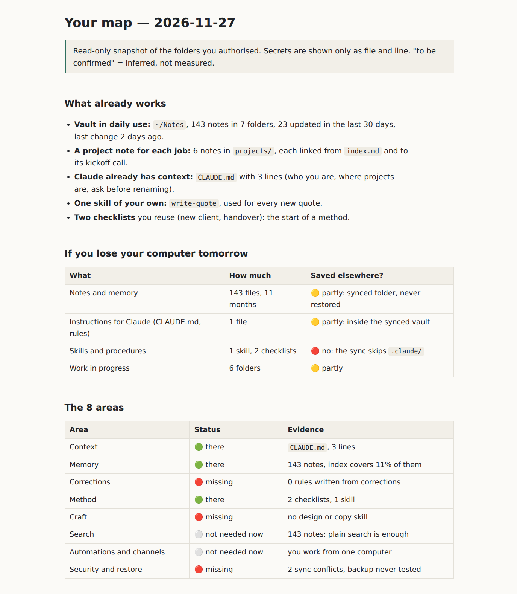
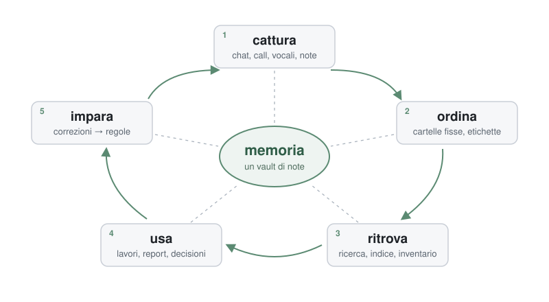

🇬🇧 [English](README.md)

# Second Brain Kit

**Claude Code si dimentica tutto fra una sessione e l'altra. Ecco cosa ho tenuto, le 45 cose che ho scartato e un onboarding guidato che prima guarda il tuo sistema e poi ti aiuta a migliorarlo.**

[](LICENSE)
[](CHANGELOG.md)
[](docs/INSTALLA.md)
[](README.md)

[English](README.md) · [Installazione](docs/INSTALLA.md) · [Catalogo](catalogo/README.md) · [Cosa ho scartato](catalogo/scartati.md)



*Esempio di MAPPA su dati finti.*

## Perché lo condivido

Sono Daniel Martines. Ho Fixer Digitale, un piccolo studio digitale in Italia, e non sono uno sviluppatore di formazione.
Lavoro ogni giorno con Claude Code e con un piccolo gruppo di agenti. Mi sono costruito un sistema per non rispiegare tutto a ogni sessione, e un po' di persone mi hanno chiesto come funziona.
Questo è il mio modo, con i suoi limiti: non è un metodo e non è l'unico giusto. Prendi quello che ti serve e lascia il resto.

Pensalo come un pezzo del mio second brain che puoi prendere in prestito. L'onboarding ti guida un passo alla volta, a qualsiasi livello: guarda cosa hai già, chiede quando non è sicuro e ti propone al massimo 3 miglioramenti. Ognuno lo decidi tu.

## Cosa ho scartato

Di solito si racconta solo quello che funziona. Io ho tenuto anche l'elenco di quello che ho provato e lasciato: 45 voci, ognuna con il motivo e con quando a te potrebbe servire lo stesso. Non sono bocciature: sono scelte fatte per il mio modo di lavorare. Tre esempi:

- **Sistemi di memoria per agenti (Mem0, Letta e simili).** Li ho lasciati perché aggiungono una seconda fonte di verità accanto alle mie note, e il problema vero erano le trascrizioni grezze che nella ricerca coprivano le note buone. Potrebbero servirti se parti da zero e un servizio a consumo ti va bene. [Di più](catalogo/scartati.md#sistemi-di-memoria-per-agenti-alternativi-a-un-vault-di-note-mem0-letta-graphiti-cognee-lightrag-claude-mem-e-simili)
- **Fidarsi di una scansione «pulita».** Ho smesso perché una scansione diceva «nessuna chiave trovata» dopo aver letto zero commit, con l'errore nascosto. Uno scanner ti serve lo stesso, se controlli quanti file o commit ha letto davvero. [Di più](catalogo/scartati.md#fidarsi-di-una-scansione-pulita-senza-guardare-cosa-ha-letto)
- **Controllare chat e canali a orario fisso.** L'ho lasciato perché voglio che memoria e avvisi partano da un evento, non da un giro ogni tot minuti. Potrebbe servirti se il servizio non manda eventi o ti basta un aggiornamento al giorno. [Di più](catalogo/scartati.md#controllare-chat-e-canali-a-orario-fisso)

[Leggi tutto quello che ho scartato](catalogo/scartati.md).

## Inizia

**Cosa serve.**
- Un piano Claude a pagamento: basta Pro. Il piano gratuito non ha Claude Code.
- [Claude Code](https://docs.claude.com/en/docs/claude-code/setup) installato, con il login fatto.
- Su Windows, [Git per Windows](https://git-scm.com/downloads/win): Claude Code lo usa anche se tu non usi git.

**Passi.**
1. Dentro Claude Code scrivi:
   ```text
   /plugin marketplace add fixerdigitale/second-brain-kit
   ```
2. Poi installa il plugin (quando te lo chiede, scegli l'installazione per te, a livello utente):
   ```text
   /plugin install second-brain@second-brain-kit
   ```
3. Chiudi Claude Code e riaprilo nella **tua** cartella di lavoro: quella dove lavori di solito, non la cartella del kit e non la tua cartella personale intera. Dal terminale entra nella cartella con `cd` e poi scrivi `claude`; da VS Code o dall'app desktop scegli quella cartella.
4. Scrivi:
   ```text
   /second-brain:onboarding
   ```
   oppure, a parole, «avvia l'onboarding».

**Quanto ci vuole.** Installazione: 2 minuti se hai già Claude Code. Primo risultato: 15-25 minuti. Giro completo: 30-45 minuti, anche in più volte.

Provato con Claude Code 2.1.141 su Linux, il 27/11/2026. Mac e Windows non ancora provati: le issue sono benvenute.

Le altre strade (zip, solo catalogo) e i dettagli per Mac, Windows e Linux sono in [docs/INSTALLA.md](docs/INSTALLA.md).

## Cosa c'è dentro

| Parte | Cosa fa | Dove |
|---|---|---|
| **Onboarding** | Prima guarda cosa hai già, con il tuo permesso: nomi e conteggi nelle tue cartelle personali; lettura completa della cartella di Claude e della cartella di lavoro che scegli tu. Poi ti dà un primo risultato concreto in 15-25 minuti, una mappa del tuo sistema e un piano di al massimo 3 passi. Dopo 14 giorni rifà le stesse misure. | [plugin/second-brain/](plugin/second-brain/) |
| **Catalogo** | 88 schede in 8 aree: memoria, ricerca, impara, automazioni, agenti, canali, skill, sicurezza. Non le uso tutte allo stesso modo: 45 «la uso», 39 «versione per PC» (adattate dal mio originale, usate molto meno), 4 «proposta» (idee che non uso così); la colonna Stato del catalogo lo dice per ognuna. Ogni scheda dice il problema, come l'ho risolto, perché così e quando **non** ti serve. | [catalogo/](catalogo/README.md) |
| **Scarti** | 45 strumenti e idee che ho provato o valutato e poi lasciato, con il motivo e quando a te potrebbero servire lo stesso. | [catalogo/scartati.md](catalogo/scartati.md) |
| **Pacchetti** | I file pronti da copiare per 64 schede: skill, hook, script, modelli di note. Ognuno ha un LEGGIMI con cosa fa, dove si copia e come si toglie. | [pacchetti/](pacchetti/) |

**Lingue.** Schede: italiano e inglese. LEGGIMI dei pacchetti: italiano, con una sezione in inglese. L'onboarding parla anche inglese, ma i file che scrive nella tua cartella (blocco del CLAUDE.md, modelli della memoria), le guide e i messaggi degli script sono per ora solo in italiano. Claude Code li legge senza problemi, e puoi chiedergli di spiegarli o tradurli mentre vai avanti.

## Per chi è

- **Se parti da zero.** L'onboarding non usa gergo, ti fa una domanda alla volta e lancia lui i comandi. Il primo risultato è un lavoro vero che rifai spesso, fatto meglio.
- **Se hai già qualche file e un CLAUDE.md.** Ti mostra dove il sistema perde pezzi (memoria, correzioni, backup) e ti propone i passi più piccoli per chiuderli.
- **Se hai già un vault, skill tue, hook e agenti.** Lo studia area per area e ti parla da pari. Probabilmente in qualche punto il tuo sistema è migliore del mio: il catalogo ti serve più come confronto che come lista da installare.

Il livello non te lo chiede: lo legge dai file, area per area. Puoi essere avanzato sulla memoria e a zero sul backup, ed è normale.

## Hai già un tuo sistema? 10 cose meno ovvie

Se hai già un sistema tuo, queste sono le cose che avrei voluto leggere prima. Prima gli scarti.

1. **Ho misurato la ricerca prima di cambiare sistema di memoria.** Il problema non erano le note, erano le trascrizioni grezze nell'indice. [Scarto: sistemi di memoria per agenti](catalogo/scartati.md#sistemi-di-memoria-per-agenti-alternativi-a-un-vault-di-note-mem0-letta-graphiti-cognee-lightrag-claude-mem-e-simili)
2. **Un modello veloce che smista non ha reso più veloce l'assistente.** La lentezza veniva dal contesto ricaricato a ogni turno. [Scarto: un modello veloce che smista](catalogo/scartati.md#un-modello-veloce-che-smista-le-richieste-prima-dellassistente-principale)
3. **Una lista «deny» può non fare niente senza dirlo.** Sui miei agenti non toccava gli strumenti nativi: un blocco lo provo prima con un caso finto. [Scarto: la lista «deny» nella configurazione del motore](catalogo/scartati.md#bloccare-gli-strumenti-degli-agenti-con-una-lista-deny-nella-configurazione-del-motore)
4. **Una scansione «pulita» può essere una scansione che non ha letto niente.** Controllo quanti file o commit ha letto. [Scarto: fidarsi di una scansione pulita](catalogo/scartati.md#fidarsi-di-una-scansione-pulita-senza-guardare-cosa-ha-letto)
5. **Il giudizio libero di un'AI è un cattivo allarme.** Il rosso lo danno controlli deterministici; l'AI scrive una nota da leggere. [Scarto: il giudizio dell'AI per il rosso](catalogo/scartati.md#far-decidere-il-rosso-di-un-controllo-al-giudizio-libero-di-unai)
6. **Correzioni con un Perché e un Come si applica.** Con il perché, Claude allarga la regola ai casi che non nomina. [Scheda](catalogo/memoria/memoria-feedback-why-how.md)
7. **Regole proposte di notte, fisse solo dopo il mio ok.** La macchina conta le ripetizioni, io decido cosa diventa regola. [Scheda](catalogo/impara/impara-regole-proposte-con-ok.md)
8. **Fatti stabili e lavoro aperto in due file diversi.** SISTEMA.md si corregge sul posto, HANDOFF.md tiene solo il lavoro aperto. [Scheda](catalogo/memoria/memoria-handoff-e-sistema.md)
9. **Un inventario di quello che c'è davvero.** Claude lo legge prima di dire «non ce l'ho» o di rifare uno strumento. [Scheda](catalogo/ricerca/ricerca-inventario-notturno.md)
10. **Una prova di ripristino, non solo un backup.** Una volta al mese riapro la copia in una cartella a parte. [Scheda](catalogo/sicurezza/sicurezza-prova-ripristino.md)

## La mia giornata con l'AI

Come usano questi pezzi insieme, dal brief del mattino al lavoro della notte: [La mia giornata con l'AI](catalogo/canali/canali-giornata-con-ai.md).
Molte cose io le faccio girare su un server. Tutto può girare anche su un PC: la differenza è che il PC non è sempre acceso, il server sì. Ogni scheda dice dove gira.



## Sicurezza

L'onboarding lavora in sola lettura finché non dici sì. In particolare non fa mai da solo queste cose:

- leggere fuori dalle cartelle che hai autorizzato, o aprire browser, email e chat;
- stampare, copiare o mettere in memoria i valori di password, chiavi e token;
- scrivere, spostare, rinominare o cancellare senza un sì per ogni voce (prima fa una copia datata, e invece di cancellare sposta in `_da-cancellare/`);
- fare push, creare repository o condividere qualcosa;
- installare skill, MCP o plugin presi da fuori senza un controllo e un sì;
- attivare hook, permessi larghi o la modalità automatica senza spiegarti l'effetto;
- mandare qualcosa all'esterno di sua iniziativa: niente telemetria, e la mappa e il piano restano nella tua cartella di lavoro (se quella cartella è sincronizzata online, te lo dice prima).

Quello che l'onboarding legge, compresi i nomi delle cartelle, passa da Claude come ogni conversazione: vale la privacy del tuo account Anthropic. Il kit non aggiunge nessun altro invio.

Solo il primo sguardo è in sola lettura imposta dal programma; il resto si regge sul fatto che Claude segua le regole e sulle richieste di permesso del tuo Claude Code: tienile accese.

Non incollare mai password o chiavi nella chat, nemmeno qui.

## Limiti onesti

- È il sistema di una persona sola, con il suo lavoro (un piccolo studio digitale) e i suoi abbonamenti (Claude Max e ChatGPT). Alcune scelte hanno senso solo lì.
- Le schede marcate «server» descrivono come lo faccio io: sul PC vanno adattate, e alcune non hanno un pacchetto.
- Le versioni per PC sono adattamenti dei miei originali: le ho usate molto meno a lungo.
- Claude Code cambia spesso. Qualche comando o impostazione potrebbe essere già diverso quando leggi.
- Il blocco che il kit propone di aggiungere al tuo `CLAUDE.md` è lungo (circa 970 parole), solo in italiano, e dà per scontato che lavori con più clienti. Chiede prima di aggiungerlo: leggi prima [`CLAUDE-blocco.md`](plugin/second-brain/modelli/CLAUDE-blocco.md) e tieni solo le parti che ti servono. Dividerlo in moduli è il prossimo lavoro che ho in lista.
- I testi sono nati in italiano; la versione inglese è una traduzione.
- Non è consulenza: su backup, permessi e dati di altre persone decidi tu, con i tuoi criteri.

## Contribuire

Lo mantengo da solo, nel tempo libero.
Mi interessa soprattutto sapere cosa non ha funzionato per te: apri una issue con il tuo sistema operativo, la versione di Claude Code e cosa è successo. Non incollare chiavi né log interi: bastano le righe intorno all'errore.
Se hai un modo migliore per fare qualcosa che sta nel catalogo, una pull request con una scheda nuova o una correzione è benvenuta. Tieni lo stesso schema delle altre schede, con la sezione «Quando non ti serve», e niente nomi di persone, clienti o dati veri.
Per un problema di sicurezza non aprire una issue pubblica: guarda [SECURITY.md](SECURITY.md).

## Licenza

[MIT](LICENSE) © 2026 Daniel Martines / Fixer Digitale, tranne `pacchetti/skill-pagine-legali/pagine-legali/` (Apache 2.0, vedi LICENSE e NOTICE in quella cartella). Usalo, cambialo, rigiralo: se ti è stato utile mi fa piacere saperlo.
