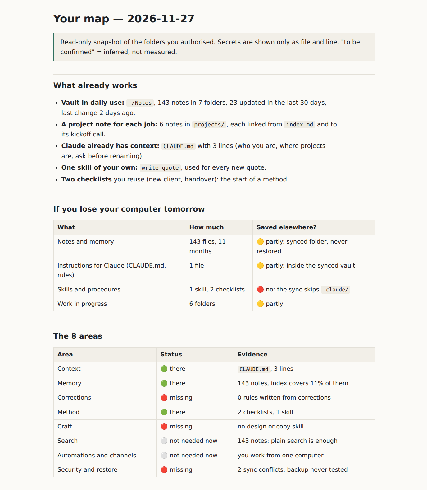
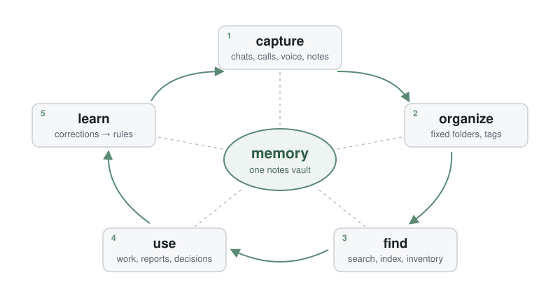

🇮🇹 [Italiano](README.it.md)

# Second Brain Kit

**Claude Code forgets everything between sessions. Here's what I kept, the 45 things I dropped, and a guided onboarding that looks at your setup first and helps you improve it.**

[](LICENSE)
[](CHANGELOG.md)
[](docs/INSTALL.md)
[](README.it.md)

[Italiano](README.it.md) · [Install](docs/INSTALL.md) · [Catalog](catalog/README.md) · [What I dropped](catalog/discarded.md)



*Example MAP on fake data.*

## Why I'm sharing this

I'm Daniel Martines. I run Fixer Digitale, a small digital studio in Italy, and I'm not a developer by training.
I work with Claude Code every day, together with a small group of agents. I built myself a setup so I don't have to re-explain everything at every session, and a few people asked me how it works.
This is my way of doing it, limits included: it isn't a method and it isn't the only right one. Take what helps you and leave the rest.

Think of it as a piece of my second brain you can borrow. The onboarding guides you one step at a time, at any level: it looks at what you already have, asks when it isn't sure, and suggests at most 3 improvements. You decide each one.

## What I dropped

People usually only talk about what works. I also kept a list of what I tried and let go: 45 entries, each with the reason and when it might still suit you. These aren't verdicts: they're choices made for the way I work. Three examples:

- **Agent memory systems (Mem0, Letta and similar).** I dropped them because they add a second source of truth next to my notes, and the real problem turned out to be raw transcripts drowning the good notes in search. They might suit you if you're starting from zero and paying per use is fine with you. [More](catalog/discarded.md#agent-memory-systems-as-an-alternative-to-a-vault-of-notes-mem0-letta-graphiti-cognee-lightrag-claude-mem-and-similar)
- **Trusting a "clean" scan.** I stopped because a scan said "no keys found" after reading zero commits, with the error hidden. A scanner still suits you if you check how many files or commits it actually read. [More](catalog/discarded.md#trusting-a-clean-scan-without-looking-at-what-it-read)
- **Checking chats and channels on a fixed schedule.** I dropped it because I want memory and alerts to start from events, not from a round every few minutes. It might suit you if the service sends no events or one update a day is enough. [More](catalog/discarded.md#checking-chats-and-channels-on-a-fixed-schedule)

[Read everything I dropped](catalog/discarded.md).

## Get started

**What you need.**
- A paid Claude plan: Pro is enough. The free plan doesn't include Claude Code.
- [Claude Code](https://docs.claude.com/en/docs/claude-code/setup) installed, with the login done.
- On Windows, [Git for Windows](https://git-scm.com/downloads/win): Claude Code uses it even if you don't use git yourself.

**Steps.**
1. Inside Claude Code, type:
   ```text
   /plugin marketplace add fixerdigitale/second-brain-kit
   ```
2. Then install the plugin (when it asks, choose the install for you, the user scope):
   ```text
   /plugin install second-brain@second-brain-kit
   ```
3. Close Claude Code and reopen it in **your own** work folder: the folder where you usually work, not the kit's folder and not your whole home folder. From the terminal, go into that folder with `cd` and then type `claude`; in VS Code or the desktop app, choose that folder.
4. Type:
   ```text
   /second-brain:onboarding
   ```
   or, in plain words, "start the onboarding".

**How long it takes.** Install: 2 minutes if you already have Claude Code. First result: 15-25 minutes. Full walk-through: 30-45 minutes, also across several sittings.

Tested with Claude Code 2.1.141 on Linux, 27/11/2026. Mac and Windows untested: issues welcome.

Other ways in (zip, catalog only) and the details for Mac, Windows and Linux are in [docs/INSTALL.md](docs/INSTALL.md).

## What's inside

| Part | What it does | Where |
|---|---|---|
| **Onboarding** | First it looks at what you already have, with your permission: names and counts in your personal folders; full read of the Claude folder and the work folder you choose. Then it gives you a first concrete result in 15-25 minutes, a map of your setup and a plan of at most 3 steps. After 14 days it takes the same measurements again. | [plugin/second-brain/](plugin/second-brain/) |
| **Catalog** | 88 cards in 8 areas: memory, search, learning, automations, agents, channels, skills, security. I don't use them all the same way: 45 "I use it", 39 "PC version" (adapted from my original, used much less), 4 "proposal" (ideas I don't use this way); the Status column in the catalog says which for each one. Each card covers the problem, how I solved it, why I did it that way, and when you **don't** need it. | [catalog/](catalog/README.md) |
| **Discarded** | 45 tools and ideas I tried or evaluated and then set aside, with the reason and when they might still be useful to you. | [catalog/discarded.md](catalog/discarded.md) |
| **Packages** | Ready-to-copy files for 64 cards: skills, hooks, scripts, note templates. Each one has a LEGGIMI (read-me) explaining what it does, where it goes and how to remove it. | [pacchetti/](pacchetti/) |

**Languages.** Cards: English and Italian. Package read-mes: Italian with an English section. The onboarding speaks English, but the files it writes into your folder (CLAUDE.md block, memory templates), the guides and the script messages are still in Italian. Claude Code reads them fine, and you can ask it to explain or translate any of them as you go.

## Who it's for

- **If you're starting from zero.** The onboarding avoids jargon, asks one question at a time and runs the commands for you. The first result is a real task you do often, done better.
- **If you already have some files and a CLAUDE.md.** It shows you where your setup is leaking (memory, corrections, backups) and suggests the smallest steps to close the gaps.
- **If you already have a vault, your own skills, hooks and agents.** It goes through your setup area by area and talks to you as a peer. Your system is probably better than mine in places: for you the catalog works more as a comparison than as a list of things to install.

It doesn't ask for your level: it reads it from your files, area by area. You can be advanced on memory and at zero on backups, and that's normal.

## Already have a setup? 10 least obvious things

If you already run your own system, these are the things I'd have liked to read earlier. The dropped ones first.

1. **I measured search before changing memory system.** The problem wasn't my notes, it was raw transcripts in the index. [Dropped: agent memory systems](catalog/discarded.md#agent-memory-systems-as-an-alternative-to-a-vault-of-notes-mem0-letta-graphiti-cognee-lightrag-claude-mem-and-similar)
2. **A fast router model didn't make my assistant faster.** The slowness came from the context reloaded every turn. [Dropped: a fast routing model](catalog/discarded.md#a-fast-model-that-routes-requests-before-the-main-assistant)
3. **A deny list can do nothing and say nothing.** On my agents it didn't touch the native tools: I test a block with a fake case first. [Dropped: a deny list in the engine's configuration](catalog/discarded.md#blocking-agents-tools-with-a-deny-list-in-the-engines-configuration)
4. **A "clean" scan can be a scan that read nothing.** I check how many files or commits it read. [Dropped: trusting a clean scan](catalog/discarded.md#trusting-a-clean-scan-without-looking-at-what-it-read)
5. **An AI's free judgment makes a poor alarm.** Red comes from deterministic checks; the AI writes a note to read. [Dropped: AI judgment for red](catalog/discarded.md#letting-an-ais-free-judgment-decide-when-a-check-goes-red)
6. **Corrections with a Why and a How to apply.** With the why, Claude generalizes to cases the rule doesn't name. [Card](catalog/memoria/memoria-feedback-why-how.md)
7. **Rules proposed overnight, made permanent only after my ok.** The machine counts the repeats, I decide what becomes a rule. [Card](catalog/impara/impara-regole-proposte-con-ok.md)
8. **Stable facts and open work in two separate files.** SISTEMA.md is corrected in place, HANDOFF.md holds only open work. [Card](catalog/memoria/memoria-handoff-e-sistema.md)
9. **An inventory of what's really there.** Claude reads it before saying "I don't have it" or rebuilding a tool. [Card](catalog/ricerca/ricerca-inventario-notturno.md)
10. **A restore test, not just a backup.** I reopen the copy in a separate folder once a month. [Card](catalog/sicurezza/sicurezza-prova-ripristino.md)

## My day with AI

How these pieces work together, from the morning brief to the overnight work: [My day with AI](catalog/canali/canali-giornata-con-ai.md).
I run a lot of this on a server. All of it can also run on a PC: the difference is that a PC isn't always on, and a server is. Each card says where it runs.



## Safety

The onboarding works read-only until you say yes. In particular, it never does any of these things on its own:

- read outside the folders you've allowed, or open your browser, email or chats;
- print, copy or store in memory the values of passwords, keys and tokens;
- write, move, rename or delete without a yes for each item (it makes a dated copy first, and instead of deleting it moves things to `_da-cancellare/`, "to delete");
- push, create repositories or share anything;
- install skills, MCP servers or plugins from outside without a check and a yes;
- turn on hooks, broad permissions or auto mode without explaining what they do;
- send anything outside on its own: no telemetry, and the map and the plan stay in your work folder (if that folder is synced online, it tells you first).

What the onboarding reads, folder names included, goes through Claude like any conversation: your Anthropic account's privacy applies. The kit adds no other sends.

Only the first look is technically read-only; the rest relies on Claude following the rules and on your permission prompts: keep them on.

Never paste passwords or keys into the chat, not even here.

## Honest limits

- It's one person's setup, shaped by my work (a small digital studio) and my subscriptions (Claude Max and ChatGPT). Some choices only make sense there.
- Cards marked "server" describe how I do it: on a PC they need adapting, and some have no package.
- The PC versions are adaptations of my originals: I've used them for much less time.
- Claude Code changes often. Some commands or settings may already be different by the time you read this.
- The block the kit offers to add to your `CLAUDE.md` is long (about 970 words), in Italian only, and assumes you work with several clients. It asks before adding it: read [`CLAUDE-blocco.md`](plugin/second-brain/modelli/CLAUDE-blocco.md) first and keep only the parts that fit you. Splitting it into modules is next on my list.
- Everything was written in Italian first; the English version is a translation.
- This isn't professional advice: on backups, permissions and other people's data, you decide, with your own judgment.

## Contributing

I maintain it on my own, in my spare time.
What I'd most like to hear is what didn't work for you: open an issue with your operating system, your Claude Code version and what happened. Don't paste keys or whole logs: the lines around the error are enough.
If you have a better way to do something that's in the catalog, a pull request with a new card or a fix is welcome. Keep the same structure as the other cards, including the "Quando non ti serve" ("When you don't need it") section, and no names of people, clients or real data.
For a security problem, please don't open a public issue: see [SECURITY.md](SECURITY.md).

## License

[MIT](LICENSE) © 2026 Daniel Martines / Fixer Digitale, except `pacchetti/skill-pagine-legali/pagine-legali/` (Apache 2.0, see LICENSE and NOTICE in that folder). Use it, change it, pass it on: if it helped you, I'd be glad to hear about it.
